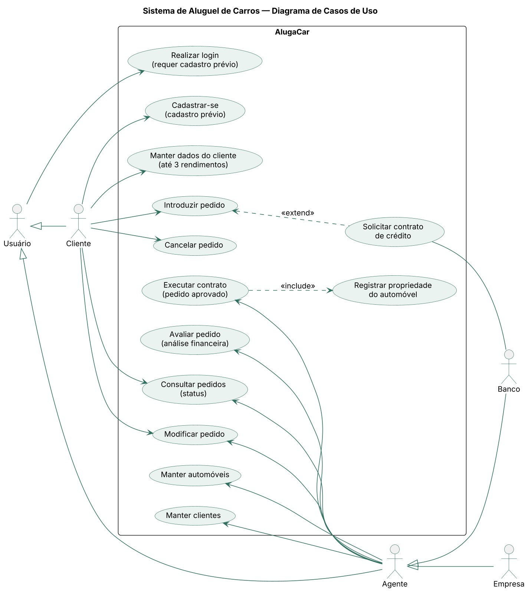
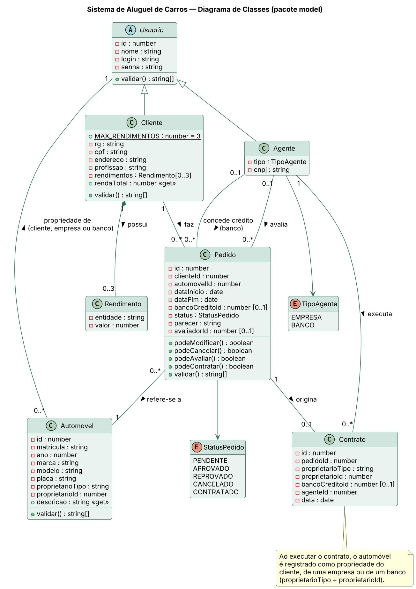
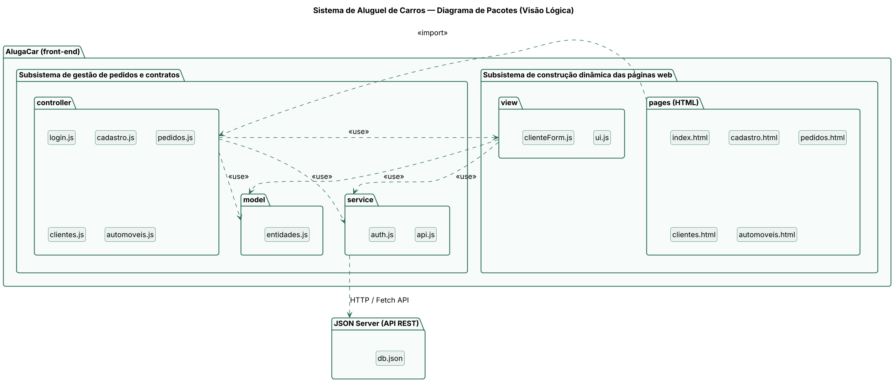
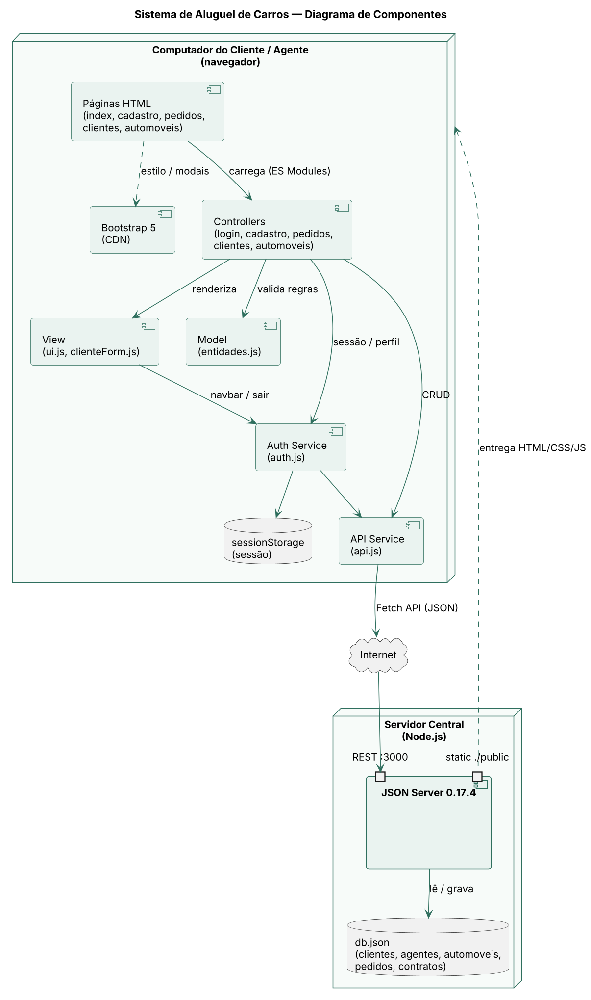
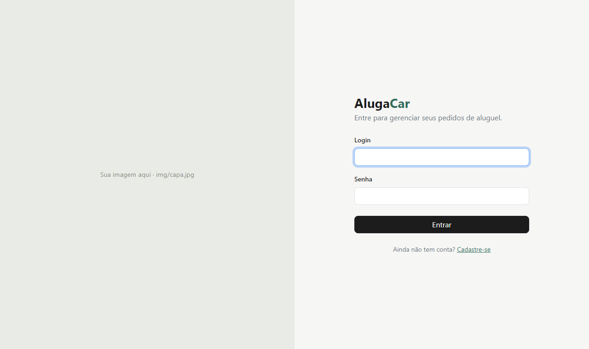
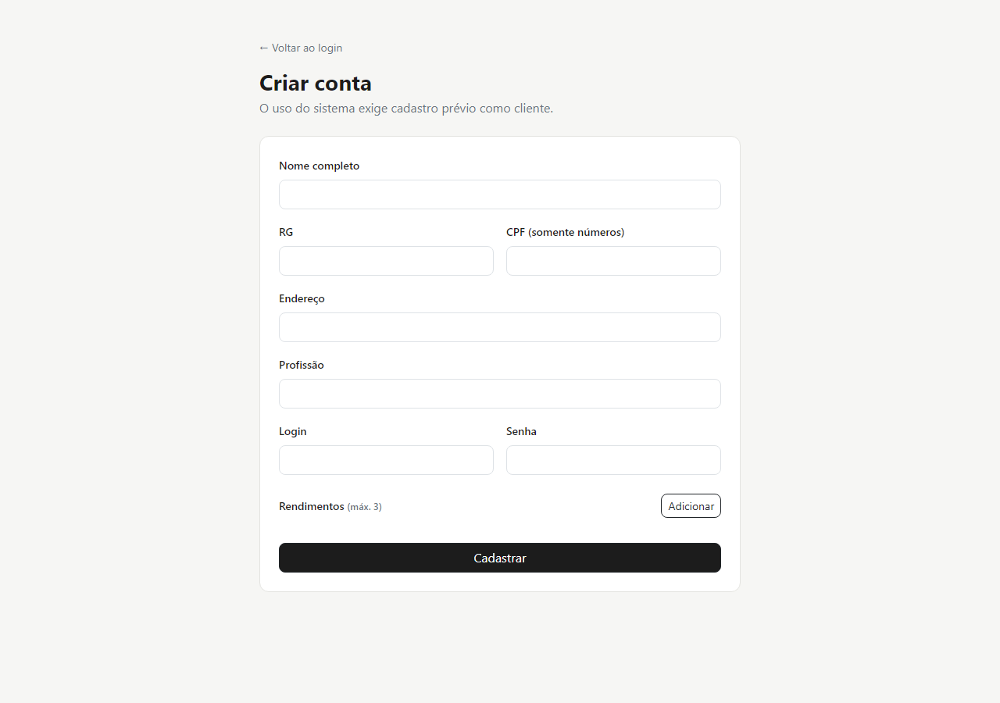
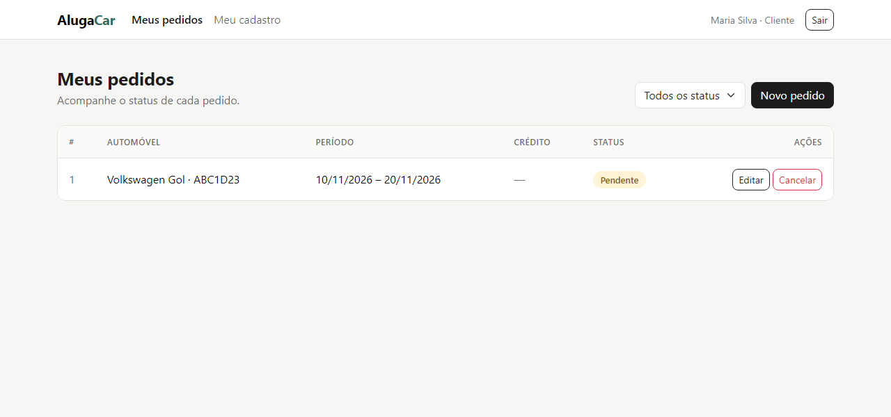
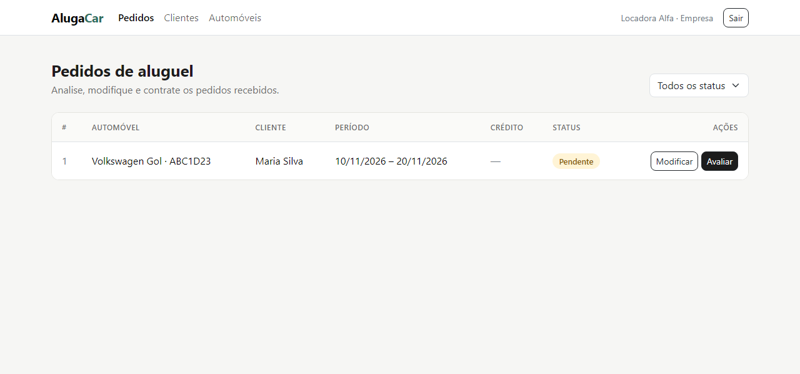
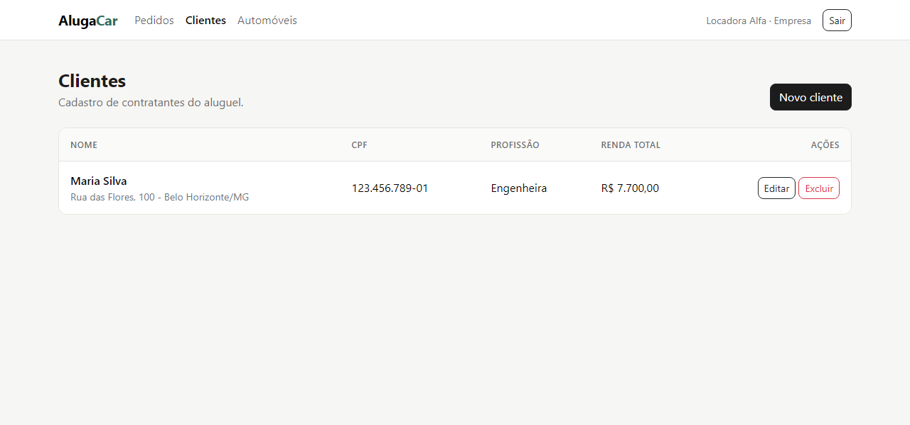
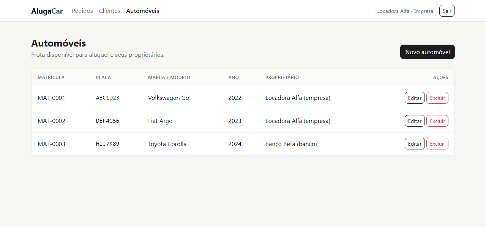

# 🚗 AlugaCar · Sistema de Aluguel de Carros 👨‍💻

> Sistema web para **efetuar, modificar, consultar e cancelar pedidos de aluguel de automóveis** pela Internet, com **avaliação financeira por agentes** (empresas e bancos) e execução de contratos.

<table>
  <tr>
    <td width="800px">
      <div align="justify">
        O <b>AlugaCar</b> é o protótipo desenvolvido no <b>Laboratório 02</b> da disciplina de <i>Desenvolvimento de Interfaces Web (DIW)</i> do curso de Engenharia de Software da PUC Minas. Clientes cadastrados fazem pedidos de aluguel e acompanham o status de cada um. Os agentes (<i>empresas</i> e <i>bancos</i>) analisam os pedidos do ponto de vista financeiro, emitem um parecer e, em caso de aprovação, executam o contrato, registrando o automóvel como propriedade do cliente, de uma empresa ou de um banco. O aluguel pode estar associado a um <b>contrato de crédito</b> concedido por um banco agente.
      </div>
    </td>
    <td>
      <div>
        <!-- Substitua pela logo do projeto -->
        
      </div>
    </td>
  </tr>
</table>

---

## 🚧 Status do Projeto


---

## 📚 Índice
- [Links Úteis](#-links-úteis)
- [Sobre o Projeto](#-sobre-o-projeto)
- [Funcionalidades Principais](#-funcionalidades-principais)
- [Tecnologias Utilizadas](#-tecnologias-utilizadas)
- [Arquitetura](#-arquitetura)
  - [Diagramas](#diagramas)
- [Instalação e Execução](#-instalação-e-execução)
  - [Pré-requisitos](#pré-requisitos)
  - [Instalação de Dependências](#-instalação-de-dependências)
  - [Como Executar a Aplicação](#-como-executar-a-aplicação)
  - [Usuários de Teste](#-usuários-de-teste)
- [Estrutura de Pastas](#-estrutura-de-pastas)
- [Demonstração](#-demonstração)
- [Testes](#-testes)
- [Documentações utilizadas](#-documentações-utilizadas)
- [Autores](#-autores)
- [Contribuição](#-contribuição)
- [Agradecimentos](#-agradecimentos)
- [Licença](#-licença)

---

## 🔗 Links Úteis
* 📄 **Enunciado:** LAB02, Sistema de Aluguel de Carros (DIW, PUC Minas)
* 📐 **Diagramas UML:** [docs/diagramas](./docs/diagramas)
* 📖 **Template do README:** [template_README.md](https://github.com/joaopauloaramuni/desenvolvimento-de-interfaces-web/blob/main/TEMPLATES/template_README.md)

---

## 📝 Sobre o Projeto

**Contexto:** projeto acadêmico do 2º período de Engenharia de Software da PUC Minas, na disciplina de Desenvolvimento de Interfaces Web, ministrada pelo Prof. João Paulo Carneiro Aramuni.

**Problema:** empresas de aluguel de automóveis precisam de um canal on-line para receber pedidos, analisá-los financeiramente e formalizar contratos, envolvendo clientes, empresas e bancos.

**Solução:** uma aplicação web em que:

- o sistema **só pode ser usado após cadastro prévio**;
- **clientes** introduzem, modificam, consultam e cancelam pedidos de aluguel;
- **agentes** (empresas e bancos) modificam e avaliam pedidos;
- pedidos com parecer positivo seguem para a **execução do contrato**;
- o automóvel pode ser registrado como propriedade do **cliente**, de uma **empresa** ou de um **banco**, conforme o tipo de contrato;
- o aluguel pode estar associado a um **contrato de crédito** concedido por um banco agente.

### Ciclo de vida do pedido

```
           ┌──────────► Cancelado (pelo cliente)
           │
Pendente ──┼──► Aprovado ──► Contratado
           │        │
           │        └─────► Cancelado (pelo cliente)
           └──► Reprovado
```

---

## ✨ Funcionalidades Principais

- 🔐 **Cadastro e Login:** autocadastro de clientes e autenticação de clientes e agentes, com sessão no navegador.
- 👤 **CRUD de Cliente:** RG, CPF, nome, endereço, profissão e até **3 rendimentos** (entidade empregadora + valor).
- 📝 **Pedidos de Aluguel (cliente):** criar, editar (enquanto pendente), consultar o status e cancelar.
- 🏦 **Contrato de Crédito:** o cliente pode solicitar crédito a um banco agente ao fazer o pedido.
- 📊 **Avaliação Financeira (agente):** resumo do cliente e da renda declarada, parecer e decisão (aprovar/reprovar).
- 📃 **Execução de Contrato (agente):** gera o contrato e registra a propriedade do automóvel (cliente, empresa ou banco).
- 🚘 **CRUD de Automóveis (agente):** matrícula, ano, marca, modelo, placa e proprietário.
- 🔎 **Filtro por status:** consulta rápida dos pedidos por situação.

### Permissões por perfil

| Ação | Cliente | Agente (empresa/banco) |
| :--- | :---: | :---: |
| Introduzir pedido | ✅ | — |
| Modificar pedido (pendente) | ✅ | ✅ |
| Consultar pedidos | ✅ (os seus) | ✅ (todos) |
| Cancelar pedido | ✅ | — |
| Avaliar pedido | — | ✅ |
| Executar contrato | — | ✅ |
| Gerenciar clientes | ✅ (o seu cadastro) | ✅ (todos) |
| Gerenciar automóveis | — | ✅ |

---

## 🛠 Tecnologias Utilizadas

Somente a stack definida no enunciado:

### 💻 Front-end

* **Estrutura e lógica:** HTML5, CSS3 e JavaScript (ES6+, com ES Modules)
* **Interface:** Bootstrap 5.3.3 (via CDN)
* **Comunicação:** Fetch API

### 🖥️ Back-end (API simulada)

* **API REST e persistência:** JSON Server 0.17.4, a partir do arquivo `db.json`
* **Runtime:** Node.js (apenas para executar o JSON Server)

---

## 🏗 Arquitetura

O front-end segue uma organização em camadas inspirada em **MVC**, com quatro pacotes que correspondem ao **Diagrama de Pacotes**:

| Pacote | Pasta | Responsabilidade |
| :--- | :--- | :--- |
| **model** | `public/js/model` | Entidades do domínio (`Usuario`, `Cliente`, `Rendimento`, `Agente`, `Automovel`, `Pedido`, `Contrato`) e regras como `validar()`, `podeCancelar()` e `podeAvaliar()`. |
| **service** | `public/js/service` | Acesso à API REST via Fetch (`api.js`) e autenticação/sessão (`auth.js`). |
| **view** | `public/js/view` | Construção dinâmica das páginas: navbar por perfil, alertas, badges de status, formatação e formulário de cliente. |
| **controller** | `public/js/controller` | Um controlador por página, que liga eventos da interface, model e service. |

Isso atende à divisão pedida no enunciado:

- **Subsistema de gestão de pedidos e contratos** → `model` + `service` + `controller/pedidos.js`
- **Subsistema de construção dinâmica das páginas web** → `view` + páginas HTML

**Fluxo de dados:** `Página HTML → controller → model (validação) → service/api.js (fetch) → JSON Server → db.json`

### Recursos da API (JSON Server)

| Recurso | Descrição |
| :--- | :--- |
| `/clientes` | Contratantes (dados de identificação, profissão, rendimentos e credenciais) |
| `/agentes` | Empresas e bancos (`tipo: "empresa" \| "banco"`) |
| `/automoveis` | Frota (`proprietarioTipo` + `proprietarioId`) |
| `/pedidos` | Pedidos de aluguel (`status`, `parecer`, `avaliadorId`, `bancoCreditoId`) |
| `/contratos` | Contratos executados (propriedade do automóvel e crédito associado) |

> [!IMPORTANT]
> O JSON Server 0.17 trata campos terminados em `Id` como chave estrangeira: ao excluir um cliente, seus pedidos também são removidos. Por isso, o agente que avaliou o pedido é guardado em `avaliadorId` (e não `agenteId`), já que esse campo começa nulo e quebraria a exclusão.

### Diagramas

| Casos de Uso | Classes |
| :---: | :---: |
|  |  |
| **Pacotes (Visão Lógica)** | **Componentes** |
|  |  |

> As histórias de usuário e as versões anteriores dos diagramas estão em [`docs/diagramas`](./docs/diagramas).

---

## 🔧 Instalação e Execução

### Pré-requisitos

* **Node.js:** versão LTS (v18 ou superior)
* **npm** (já vem com o Node.js)
* Um navegador moderno

### 📦 Instalação de Dependências

```bash
git clone <URL_DO_SEU_REPOSITÓRIO>
cd lab-02-DIW-Puc-Minas
npm install
```

### ⚡ Como Executar a Aplicação

Um único comando sobe a API e serve as páginas:

```bash
npm start
```

🚀 Acesse **http://localhost:3000**

| Endereço | Conteúdo |
| :--- | :--- |
| `http://localhost:3000` | Aplicação web (pasta `public/`) |
| `http://localhost:3000/pedidos` | Exemplo de recurso da API |

> [!NOTE]
> A aplicação usa **ES Modules**, então precisa ser aberta por um servidor HTTP (como o próprio JSON Server) e não com duplo clique no arquivo `.html`.

### 👥 Usuários de Teste

| Perfil | Login | Senha |
| :--- | :--- | :--- |
| Cliente (Maria Silva) | `maria` | `123` |
| Agente · Empresa (Locadora Alfa) | `empresa` | `123` |
| Agente · Banco (Banco Beta) | `banco` | `123` |

> [!WARNING]
> As senhas ficam em texto puro no `db.json`. Isso é aceitável apenas por se tratar de um protótipo acadêmico.

---

## 📂 Estrutura de Pastas

```
.
├── db.json                     # 💾 "Banco de dados" do JSON Server (dados iniciais)
├── package.json                # 📦 Dependência (json-server) e script "npm start"
├── README.md                   # 📘 Documentação principal
├── docs/
│   └── diagramas/              # 📐 Diagramas UML e todas as suas versões
└── public/                     # 🌐 Front-end servido pelo JSON Server
    ├── index.html              # 🔐 Login
    ├── cadastro.html           # 📝 Cadastro prévio de cliente
    ├── pedidos.html            # 📋 Pedidos (cliente e agente)
    ├── clientes.html           # 👤 CRUD de clientes
    ├── automoveis.html         # 🚘 CRUD de automóveis (agente)
    ├── css/style.css           # 🎨 Estilos complementares ao Bootstrap
    ├── img/                    # 🖼️ Imagens (capa.jpg da tela de login)
    └── js/
        ├── model/              # 🧬 Entidades e regras de negócio
        ├── service/            # 🔌 Fetch API e autenticação
        ├── view/               # 🧱 Construção dinâmica da interface
        └── controller/         # 🎮 Um controlador por página
```

---

## 🎥 Demonstração

### 🌐 Aplicação Web

| Login | Cadastro |
| :---: | :---: |
|  |  |
| **Pedidos (Cliente)** | **Pedidos (Agente)** |
|  |  |
| **Clientes** | **Automóveis** |
|  |  |

### 💻 Exemplo de chamada à API

```bash
curl "http://localhost:3000/pedidos?clienteId=1"
```

**Saída esperada:**
```json
[
  {
    "id": 1,
    "clienteId": 1,
    "automovelId": 1,
    "dataInicio": "2026-11-10",
    "dataFim": "2026-11-20",
    "bancoCreditoId": null,
    "status": "Pendente",
    "parecer": "",
    "avaliadorId": null
  }
]
```

---

## 🧪 Testes

Testes manuais sugeridos (roteiro da apresentação):

1. Cadastrar um novo cliente com 3 rendimentos; o botão "Adicionar" fica bloqueado no 3º.
2. Como cliente, criar um pedido com contrato de crédito no **Banco Beta**.
3. Editar o pedido enquanto estiver **Pendente**.
4. Entrar como `banco`, **avaliar** o pedido e aprovar com um parecer.
5. **Executar o contrato**, registrando o automóvel como propriedade do banco.
6. Voltar como cliente e conferir o status **Contratado** e o proprietário.
7. Criar outro pedido e **cancelá-lo**.

---

## 🔗 Documentações utilizadas

* 📖 [Documentação do **Bootstrap 5**](https://getbootstrap.com/docs/5.3/getting-started/introduction/)
* 📖 [**JSON Server**: repositório e documentação](https://github.com/typicode/json-server/tree/v0.17.4)
* 📖 [**Fetch API** (MDN)](https://developer.mozilla.org/pt-BR/docs/Web/API/Fetch_API)
* 📖 [**JavaScript Modules** (MDN)](https://developer.mozilla.org/pt-BR/docs/Web/JavaScript/Guide/Modules)
* 📖 [Projetos de exemplo da disciplina](https://github.com/joaopauloaramuni/desenvolvimento-de-interfaces-web)
* 📖 [**Conventional Commits**](https://www.conventionalcommits.org/pt-br/v1.0.0/)

---

## 👥 Autores

| 👤 Nome | 🖼️ Foto | :octocat: GitHub | 💼 LinkedIn | 📤 Gmail |
|---------|----------|-----------------|-------------|-----------|
| Seu Nome | <div align="center"></div> | <div align="center"><a href="https://github.com/PedrolzAlves"></a></div> | <div align="center"><a href="https://www.linkedin.com/in/seu-perfil"></a></div> | <div align="center"><a href="mailto:pedrolsa2006@gmail.com"></a></div> |

---

## 🤝 Contribuição

1. Faça um `fork` do projeto.
2. Crie uma branch para sua feature (`git checkout -b feature/minha-feature`).
3. Faça commit das mudanças (`git commit -m 'feat: adiciona nova funcionalidade'`), seguindo [Conventional Commits](https://www.conventionalcommits.org/pt-br/v1.0.0/).
4. Faça `push` para a branch (`git push origin feature/minha-feature`).
5. Abra um **Pull Request**.

---

## 🙏 Agradecimentos

* [**Engenharia de Software PUC Minas**](https://www.instagram.com/engsoftwarepucminas/): pelo apoio institucional e pela estrutura acadêmica.
* [**Prof. Dr. João Paulo Aramuni**](https://github.com/joaopauloaramuni): pela orientação na disciplina de Desenvolvimento de Interfaces Web.

---

## 📄 Licença

Este projeto é distribuído sob a **Licença MIT**.

---
